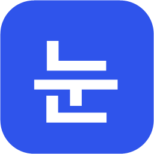

# 눈치 (Nunchi)

macOS 입력기 [Araso](https://github.com/nyttastudio/araso)(아라소)를 바탕으로 만든 Windows 입력기입니다.
영문(QWERTY) 자판으로 치면 단어마다 영어인지 한국어인지 알아보고 맞는 글자로 넣습니다. 한/영 키를 누를 일이 없습니다.

```
Stay hungry, stay foolishsms wkqtmdml akfdlek.  →  Stay hungry, stay foolish는 잡스의 말이다.
dlrjs githubdp commitgkf rjdi.                   →  이건 github에 commit할 거야.
PDFvkdlf hellodnjfem                             →  PDF파일 hello월드
```

판단 로직은 원본 ArasoCore(Swift)를 Rust로 그대로 옮겼고, 입력기 껍데기는 Windows의 TSF(Text Services
Framework)로 새로 만들었습니다. 옮긴 기준은 원본 커밋 [22e7d3d](https://github.com/nyttastudio/araso/commit/22e7d3d)이고,
단어 목록과 모델도 그때의 것을 `data/`에 그대로 복사했고, 빌드할 때 표로 바꿔 DLL에 넣습니다. 입력기는 모든 앱 안에서
돌기 때문에, 앱마다 목록을 읽어 올리는 대신 DLL의 표를 함께 씁니다(앱 하나당 추가 메모리 약 1~2 MB, 키 하나 판단 0.04 ms 이하).

> **비공식 포트입니다.** 원본 Araso 개발자(nyttastudio)와 관계없이 만들고 있습니다.

> 상태: **개발 중 (0.1)**. 영어·한국어는 동작하고, 일본어 한자 변환은 아직 없습니다.

## 설치

1. [Releases](https://github.com/mununki/nunchi/releases)에서 `Nunchi-Setup-<버전>.exe`를 받아 실행합니다(관리자 확인 한 번).
   64비트와 32비트 앱(카카오톡 등)용 입력기를 함께 `Program Files\Nunchi`에 설치합니다. 서명하지 않은 설치 파일이라
   SmartScreen이 막으면 "추가 정보" → "실행"을 누르세요.
2. "눈치를 기본 입력기로 지정"을 켜 두면 재부팅해도 눈치로 시작합니다. 끄면 키보드 목록에만 넣습니다.
3. **Win+Space**로 한국어 → 눈치를 고릅니다. 설치가 끝나면 쓰는 법(키, 작업 표시줄 아이콘, 설정, 문제가 생기면)을
   한 쪽으로 보여 줍니다.

x64 Windows 10·11용입니다(ARM64 Windows에선 시스템 앱에서 돌지 못해 설치하지 않습니다). C 런타임을 함께 넣어서
VC++ 재배포 패키지는 없어도 됩니다.

업데이트는 새 설치 파일을 다시 실행하면 됩니다. 이미 열려 있는 앱은 다시 시작해야 새 버전을 씁니다.
제거는 설정 → 앱 → 설치된 앱의 눈치에서 하고, 설정과 학습한 단어(`%APPDATA%\Nunchi`)는 남습니다. 열려 있는 앱이
쓰던 파일은 다시 시작할 때 지워지고(그래서 다시 시작할지 묻습니다), 그 전에 다시 설치해도 됩니다.

## 되는 것

- 단어마다 영어/한국어 판단(두벌식, 세벌식 최종), 앞 단어의 언어 쪽으로 기울이기
- 섞인 단어: `github에`, `x에`, `PDF파일`, `hello월드`
- 언어 바꾸기 키로 치고 있는 단어와 **방금 확정한 단어** 고치기, 같은 쪽으로 두 번 고치면 학습(`dictionary.json`)
- 한국어 Delete(치는 글자는 자모 하나씩, 그 앞은 글자째), URL·경로 안에서는 친 그대로
- 앱별 설정(`apps.json`: 끄기, 엄격하게, `holdSpace`), 일시정지 키, Colemak/Colemak-DH, vim 모드 연동(신호를 보내는 쪽은 아직)
- 작업 표시줄의 입력 표시기에 상태 아이콘(눈치 아이콘 왼쪽): **가**는 켜짐, 오른쪽 위에 빨간 ×가 붙은 **가**는 이
  입력창에서 일시정지했거나 이 앱에서 꺼짐(친 그대로 들어감). 누르면 일시정지/다시 켜기, 오른쪽 클릭하면 메뉴(일시정지,
  이 앱에서 끄기, 설정…)
- 설정 창(작업 표시줄 아이콘의 메뉴, 시작 메뉴의 "눈치 설정"): 자판, 언어 바꾸기·일시정지 키, 앱별 규칙, 학습한 단어
  보기·더하기·지우기
- 일본어는 로마자 → 가나 판단까지만(기본 꺼짐, 한자 변환 없음)

## 키 (Windows 기본값)

| 하는 일 | 기본 키 | 원본(macOS) |
|---|---|---|
| 언어 바꾸기 (영어 → 영어+조사 → 한국어 …) | **한/영 키**, 오른쪽 Alt 단독, Shift+Esc | 오른쪽 ⌥ 단독, ⇧Esc |
| 이 입력창에서 일시정지 | **한자 키**(없으면 오른쪽 Ctrl 단독) | 오른쪽 ⌘ 단독 |

`settings.json`의 `pauseKey`, `apps.json`의 `switchKeys`로 바꿀 수 있습니다. 이름은 `hangulKey`, `rightAlt`,
`rightShift`, `escape`, `shiftEscape`(언어 바꾸기)와 `hanjaKey`, `rightControl`, `rightAlt`, `rightShift`, `off`(일시정지)입니다.
원본의 `rightOption`, `rightCommand`도 읽습니다.

## 설정 파일

설정 창에서 바꾸는 것은 `%APPDATA%\Nunchi\`의 JSON에 원본과 같은 형식으로 저장되고, 직접 고쳐도 됩니다. 앱은 실행 파일
이름(소문자)으로 씁니다. 예전 이름(Araso) 때의 `%APPDATA%\Araso`는 처음 실행할 때 이리로 옮겨 옵니다.

```json
// apps.json
{ "*": { "switchKeys": ["hangulKey", "shiftEscape"] },
  "windowsterminal.exe": { "conversionThreshold": 0.97, "holdSpace": true },
  "game.exe": { "enabled": false } }
```

바꾼 내용은 2초 안에 모든 앱에 반영됩니다. 설정 창 정보 탭의 "진단 기록 남기기"를 켜면(`%APPDATA%\Nunchi\logging`
파일) 그 뒤에 여는 앱부터 `logs\`에 진단 기록을 남깁니다(키의 종류만, 친 글자는 남기지 않습니다). 설정 창이 열리지
않는 PC(그래픽 드라이버 등)에서는 그 까닭과 함께 이 파일들을 직접 고치라고 알려 줍니다.

## 빌드와 테스트

Rust(stable, MSVC)와 Visual Studio Build Tools(C++ 워크로드)가 필요합니다. 32비트 앱(카카오톡 등)용 DLL도 만들려면
`rustup target add i686-pc-windows-msvc`를 한 번 실행하세요. C 런타임은 정적으로 링크합니다(`.cargo/config.toml`).

```bash
cargo test --release -p nunchi-core -p nunchi-tsf -p nunchi-settings
cargo run -p nunchi-cli -- -v "dkssud hello githubdp"
```

테스트는 세 층입니다. 앞의 둘은 키보드를 쓰지 않아 언제든, CI에서도 돕니다.

- `nunchi-core`: 판단 엔진과 입력 세션 테스트 170개(대부분 원본 Swift 테스트를 옮긴 것)
- `nunchi-tsf`: 입력기가 실제 EDIT·RichEdit 컨트롤에 단어를 넣고 바꾸는 방식(탐색기, 카카오톡). 키 대신 세션을 직접
  불러서, 아래 실제 키 테스트와 같은 케이스 파일을 씁니다.
- 실제 키 테스트: 진짜 키 입력으로 입력란 종류마다(EDIT, IMM32 자체 처리, RichEdit TSF, RichEdit IMM32), 64·32비트,
  스토어 앱 샌드박스까지. 커밋 전에 돌립니다.

```bash
powershell -ExecutionPolicy Bypass -File scripts/typing-tests.ps1
```

개발 빌드를 새로 넣고 1분쯤 키를 칩니다. 그동안 키보드를 이 PC에 두고 건드리지 마세요(네트워크 KVM이면 다른
컴퓨터로 키가 갈 수 있음). 끝에 요약을 보여 주고, 하나라도 틀리면 실패로 끝납니다. `-Installed`는 설치한 눈치로,
`-Browser`는 Chrome(없으면 Edge)까지 시험합니다.

케이스는 `crates/nunchi-typing-test/cases/*.tsv`에 `키<TAB>입력란에 보일 글자<TAB>입력란` 한 줄씩입니다. 마지막 칸은
그 케이스가 맞는 입력란이고(`-imm`: 그것만 빼고, `edit,richedit-imm`: 그것만, 비우면 전부), 알려진 한계를 적어 둡니다.
버그를 고치면 그 증상을 케이스로 더하세요. 단어를 바꾸면 학습하기 때문에 언어 바꾸기 케이스는 `switch.tsv`에 모아
맨 마지막에 돕니다.

## 개발하면서 써 보기

개발 빌드는 **"눈치 (개발)"**이라는 별도 입력기로 등록됩니다(`--features dev`: 다른 클래스와 프로필). 설치한 눈치와
키보드 목록에 나란히 있고 서로 덮어쓰지 않으니, 평소엔 눈치를 쓰다가 시험할 때만 Win+Space로 바꾸면 됩니다.
설정과 학습한 단어는 둘이 같이 씁니다.

```bash
powershell -ExecutionPolicy Bypass -File scripts/dev-register.ps1
```

64비트와 32비트 DLL을 `target\dev`에 빌드하고, 관리자 권한(UAC)을 한 번 물은 뒤 `target\dev-install`의 사본을
각각의 `regsvr32`로 등록하고, 키보드 목록에 "눈치 (개발)"을 넣습니다. 처음 한 번만 하면 됩니다.

- 고친 뒤 다시 넣기: `scripts/dev-update.ps1` (UAC 없이, 두 DLL 모두, 새로 여는 앱부터 반영)
- 실제 키 입력 테스트 하나만: `cargo run --release -p nunchi-typing-test -- --dev --richedit` (`--imm`: IMM32 앱처럼,
  `--richedit-imm`: 카카오톡 입력창처럼 IMM32로 쓰는 RichEdit, 옵션 없이: Win32 EDIT, `--dev`를 빼면 설치한 눈치). 32비트 앱으로 확인하려면 `--target i686-pc-windows-msvc`를 붙입니다. 자기 창을 띄워
  몇 초간 키보드를 쓰고, 포커스를 잃으면 멈춥니다. 끝에 어느 DLL이 입력을 맡았는지와 메모리를 보여 줍니다.
  `--appcontainer`는 스토어 앱과 같은 샌드박스 안에서, `--browser`는 Chrome(없으면 Edge)의 입력란에서(지금 고른
  입력기로, 따로 만든 프로필로) 시험하고, `--log`는 진단 기록(키의 종류와 입력란의 종류)을 끝에 보여 줍니다.
- 키가 실제로 보내는 신호 보기: `scripts/key-check.ps1` (키캡 없는 한/영·한자 키, 맥 배열 키보드)
- 제거: `scripts/dev-register.ps1 -Unregister`

## 설치 파일 만들기

```bash
powershell -ExecutionPolicy Bypass -File scripts/build-installer.ps1
```

[Inno Setup 6](https://jrsoftware.org/isinfo.php)(`winget install JRSoftware.InnoSetup`)이 필요하고,
`target\installer\Nunchi-Setup-<버전>.exe`가 나옵니다(버전은 `Cargo.toml`). GitHub에 `v0.1.0` 같은 태그를 올리면
CI(`.github/workflows/ci.yml`)가 같은 설치 파일을 만들어 릴리스에 올립니다. 푸시할 때마다 키보드 없는 테스트와
64·32비트 빌드도 돌고, 실제 키 테스트도 러너에 입력기를 등록해 돌립니다(러너의 데스크톱에서 믿을 만한지 지켜보는
중이라, 이 작업은 실패해도 빌드를 막지 않음).

## 구조

| 경로 | 내용 |
|---|---|
| `crates/nunchi-core` | 원본 ArasoCore를 옮긴 판단 엔진과 `InputSession`(플랫폼 코드 없음) |
| `crates/nunchi-tsf` | TSF 입력기 DLL: 키 → `InputSession`, 조합 문자열 ↔ TSF composition |
| `crates/nunchi-settings` | 설정 창(egui): 설정, 앱별 규칙, 학습한 단어 |
| `crates/nunchi-cli` | 원본 `araso-cli`와 같은 명령줄 도구 |
| `crates/nunchi-typing-test` | 진짜 키 이벤트로 입력해 보는 테스트, 케이스(`cases/`)는 `nunchi-tsf` 테스트와 같이 씀 |
| `data/` | 단어 목록과 모델(원본에서 복사), 출처와 라이선스는 `data/README.md` |
| `docs/` | README에 쓰는 아이콘(`tools/make-icon.ps1`이 입력기 아이콘과 함께 그림) |

## 알려진 한계

- **IMM32 앱**은 Windows의 호환 계층을 거쳐 조합 중인 한글을 한 글자만 보여 줍니다. 클래식 입력란(EDIT·RichEdit:
  탐색기의 이름 바꾸기, 카카오톡 입력창, 대화 상자)에는 눈치가 단어를 직접 넣어서 TSF 앱과 똑같이 동작합니다(서식이
  없는 EDIT에서는 치는 단어에 밑줄이 없습니다). 그 밖의 IMM32 앱
  (Qt, Java, 많은 게임)에서는 치는 단어가 커서 위의 작은 창(밑줄)에 보이고 단어가 끝날 때 한 번에 들어가며, 확정한
  글자를 입력기에 돌려주지 못해 *확정한 뒤에 고치기*가 안 됩니다. 그런 앱에서는 `holdSpace`를 켜면 Space 뒤에도
  단어를 잡아 둡니다(원본의 터미널 대책과 같음). 치는 중에 바꾸기는 됩니다.
- 스토어(샌드박스) 앱 안에서는 `%APPDATA%\Nunchi`를 못 읽어서 기본 설정으로 동작하고, 학습한 단어도 저장되지 않습니다.
- 업데이트 확인, 일본어 한자 변환(MS-IME 엔진 연동 예정)이 없습니다.

## 라이선스

코드는 MIT입니다(`LICENSE`, 원본의 저작권 표시 포함). `data/`의 파일은 만든 재료의 라이선스를 따르고(Tatoeba
CC BY 2.0 FR, SCOWL, FrequencyWords CC BY-SA 4.0, Webster's 2nd 퍼블릭 도메인), 자세한 내용은
`THIRD-PARTY.md`와 `data/README.md`에 있습니다.
